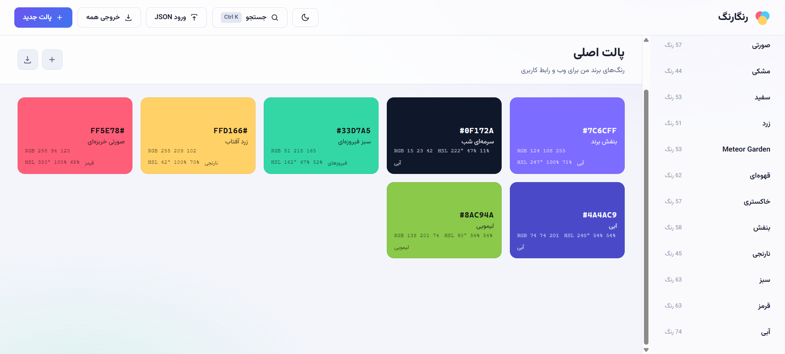

<p align="center">
  📄 Read in Persian: <a href="README.fa.md"><b>فارسی</b></a>
</p>

<p align="center">
  
</p>

# Rangarang (رنگارنگ) 🎨
### Local-first color palette manager for Chrome

**Rangarang** is a Chrome extension for creating, organizing and exporting color palettes entirely inside your browser. No PHP server, no database — every palette stays on your device.

---

## 📥 Download

The extension ships with this repository; no external store listing is linked here.

<p align="center">
  <a href="https://github.com/AmirBahadorAmiri/Rangarang/archive/refs/heads/main.zip"><b>⬇️ Download Rangarang from GitHub</b></a>
</p>

---

## 🌟 Key Features

### 📋 Palette Management
*   Create, rename and delete palettes and the colors inside them.
*   **Drag & drop reordering:** arrange colors in exactly the order you want.
*   Star important colors and find anything with Ctrl+K search.

### 🎨 Color Tools
*   Add colors with a HEX code or the built-in color picker.
*   Lighten and darken a color by 10% from the right-click menu.
*   Automatic RGB, HSL and Persian color-family labels on every swatch.

### 💾 Export & Backup
*   Export a palette as CSS Variables, SCSS, JSON, Tailwind or TXT.
*   **Full JSON backup:** export every palette at once and import it back later.
*   Invalid colors are skipped and counted when importing a JSON file.

### 🔎 Interface
*   Full RTL Persian interface with a sticky palette header.
*   Light and dark themes with automatic system detection.
*   Custom right-click context menu for quick color and palette actions.

---

## 🛠 Technologies Used

Rangarang is built with plain web technologies and Chrome's extension APIs:

*   **Language:** JavaScript (no build step)
*   **Architecture:** Chrome Extension Manifest V3 with a background service worker
*   **Storage:** chrome.storage.local (all palettes stay on your device)
*   **UI:** HTML5, CSS3, vanilla JavaScript
*   **Design:** RTL Persian light/dark themes with glass accents
*   **Backend:** none — no server and no database

---

## 🚀 Installation & Run Guide

1. First, clone the project from GitHub:
```bash
git clone https://github.com/AmirBahadorAmiri/Rangarang.git
```
2. Open Chrome and navigate to `chrome://extensions`.
3. Enable **Developer mode** in the top-right corner.
4. Click **Load unpacked** and select the `extension` folder.
5. Click the Rangarang toolbar icon to open the app in a Chrome tab.

---

## 📸 Screenshots

The interface is fully RTL and Persian; this is a palette view in a Chrome tab.

| 📸 Palette view |
|:---:|
|  |

---

## 👨‍💻 Developer
Developed by **Amir Bahador Amiri**

> [!TIP]
> Run **Export all** to save a JSON backup before clearing browser data; clicking the toolbar icon always opens Rangarang in a full tab.
